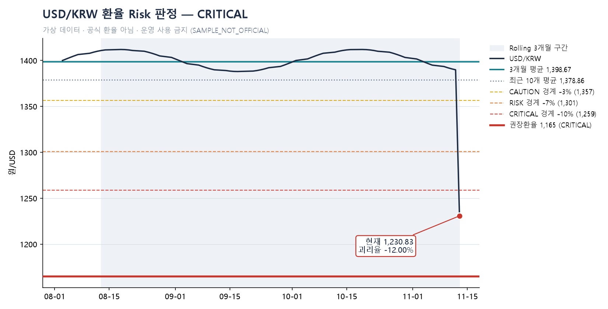

# 해외견적 환율 자동 산정 및 Risk 관리

제조기업 수출 견적에서 USD/KRW 환율을 어떻게 잡을지 판단하는 **로컬 실행 CLI 프로토타입**입니다.
CSV의 환율 이력으로 3개월 평균, 최근 10개 관측값 평균, 괴리율, 위험등급(Risk), 권장 견적환율을 계산해 JSON으로 출력합니다.

> **주의:** `data/`의 CSV는 기능 시연을 위한 **가상 데이터**입니다. 공식 환율이 아니며 운영·견적·금융 판단에 사용하지 마세요. 출력 JSON에는 `"source": "SAMPLE_NOT_OFFICIAL"`이 표시됩니다.

## 기획 의도

수출 견적은 견적 시점의 환율이 급락하면 수출대금의 원화 환산액이 줄어 손해를 볼 수 있습니다. 현재 환율이 최근 3개월 평균보다 얼마나 낮은지(괴리율)로 위험을 등급화하고, 등급에 따라 안전율과 기준 환율을 달리 적용한 **보수적인 권장 견적환율**을 제안합니다.

## 기능

- CSV 로드와 검증: 헤더, 날짜 형식, 양수·유한 값, 중복 날짜, 빈 파일을 검사하고 설명 가능한 `ValueError`를 냅니다.
- Rolling 3개월 평균, 최근 10개 관측값 평균, 괴리율 계산
- Risk 등급(NORMAL/CAUTION/RISK/CRITICAL) 판정과 5원 단위 내림 권장환율
- `--output`으로 JSON 저장, 입력 오류 시 메시지 출력 후 종료 코드 1
- (선택) 환율 추이·3개월 평균·Risk 경계선·권장환율을 한 장에 보여주는 PNG 그래프

## 실행 방법

요구 사항: Python 3.11 이상, 외부 패키지 없음.

```bash
# 계산 (기본 샘플)
python main.py --csv data/sample_rates.csv --output result.json

# 등급별 시나리오
python main.py --csv data/scenario_critical.csv --output result.json

# 테스트
python -m unittest -v
```

입력 CSV 컬럼: `date`(YYYY-MM-DD), `usd_krw`(양수).

### 실행 결과 예 (`data/scenario_critical.csv`)

```json
{
  "as_of": "2026-11-13",
  "current": 1230.83,
  "avg10": 1378.858,
  "avg3": 1398.6724,
  "deviation_pct": -12.0001,
  "risk": "CRITICAL",
  "safety_pct": 5.0,
  "basis": 1230.83,
  "calculated": 1169.2885,
  "recommended": 1165,
  "observations_3m": 67,
  "source": "SAMPLE_NOT_OFFICIAL"
}
```

## 그래프 (선택)

그래프만 matplotlib(3.8 이상)이 필요합니다. 계산과 테스트는 설치 없이 동작합니다.
`pip`이 다른 Python을 가리키거나 "externally-managed-environment" 오류가 나는 환경이 있으므로, 가상환경을 만들어 `python -m pip`로 설치하는 방법을 권장합니다.

**Windows (PowerShell)**

```powershell
python -m venv .venv
.\.venv\Scripts\python -m pip install "matplotlib>=3.8"
.\.venv\Scripts\python scripts\plot_result.py --csv data\scenario_critical.csv --output docs\charts\chart_critical.png
.\.venv\Scripts\python scripts\plot_result.py --all   # 모든 샘플을 docs\charts\에 생성
.\.venv\Scripts\python -m unittest                    # 그래프 테스트 포함 23건
```

**macOS / Linux**

```bash
python3 -m venv .venv
.venv/bin/python -m pip install "matplotlib>=3.8"
.venv/bin/python scripts/plot_result.py --all
```

- `.venv/`는 `.gitignore`에 포함되어 커밋되지 않습니다.
- 한글 글꼴은 Windows는 Malgun Gothic, macOS는 AppleGothic을 쓰고, Linux는 NanumGothic 또는 Noto Sans CJK KR이 있어야 합니다. 없으면 한글이 깨져 보일 수 있습니다.
- matplotlib 없이 실행하면 `오류: matplotlib이 필요합니다` 메시지가 나옵니다.



회색 띠가 Rolling 3개월 구간이고, 점선은 3개월 평균 대비 -3/-7/-10% 경계, 굵은 선이 권장환율입니다. 다른 등급은 `docs/charts/`에 있습니다.

## 정책

괴리율 = (현재 환율 / 3개월 평균 − 1) × 100

| Risk | 조건 | 기준 환율 | 안전율 |
|---|---|---|---|
| NORMAL | 괴리율 ≥ -3% | 3개월 평균 | 3% |
| CAUTION | -7% < 괴리율 < -3% | 최근 10개 관측값 평균 | 3% |
| RISK | -10% < 괴리율 ≤ -7% | min(현재, 10개 평균) | 4% |
| CRITICAL | 괴리율 ≤ -10% | min(현재, 10개 평균) | 5% |

- 권장환율 = 기준 환율 × (1 − 안전율), **5원 단위 내림**. 업무용 정책(반올림)과 달라서 실제 운영 전에 정책 확정이 필요합니다.
- 3개월 구간은 최신 유효일 기준 달력상 3개월 전부터입니다(월말은 말일로 보정, 예: 5/31 → 2/28).
- 3개월 구간 안의 관측값이 40개 미만이거나 전체 10개 미만이면 계산하지 않고 오류를 냅니다.
- 영업일은 공식 소스가 고시한 유효 행을 전제로 하며, CSV의 행을 영업일로 간주합니다.

## 프로젝트 구조

```
main.py                   CLI
src/fx_core.py            계산 엔진 (로드·검증·Risk 판정)
data/                     가상 샘플 CSV (기본 1종 + 등급별 4종), data/README.md
docs/sample_result*.json  샘플별 기대 결과
docs/presentation.pptx/.pdf 발표자료 8장
docs/agent_log.md         LLM 코딩 에이전트 실행 기록
scripts/make_scenarios.py 시나리오 CSV 재생성
scripts/plot_result.py    그래프 PNG 생성 (matplotlib 필요)
docs/charts/              등급별 그래프 PNG
tests/test_fx.py          단위 테스트 23건
```

## 테스트

`python -m unittest`로 23건을 실행합니다. 그래프 테스트 1건은 matplotlib이 없으면 건너뜁니다(22건 실행).

| 구분 | 내용 |
|---|---|
| TC01 | 수기 계산과 일치 (평균, 괴리율, 권장환율) |
| TC02 | 경계 -3/-7/-10% 및 직전·직후 값 |
| TC03 | 데이터 부족, 빈 파일, 헤더 누락, 잘못된 값, 중복 날짜 |
| TC04 | 같은 입력이면 같은 결과 (CLI 2회 실행 포함) |
| TC05 | 월말 기준 3개월 계산 |
| 시나리오 | 등급별 CSV가 의도한 Risk와 저장된 JSON을 재현 |

## LLM 활용 과정

**출처 구분:** 최초 코드(계산 엔진, CLI, 샘플, 테스트 4건)는 ChatGPT가 만든 초안입니다. 이후의 코드 리뷰, 결함 수정, 테스트 보강, 시나리오 데이터 추가는 **Claude Code(Claude Sonnet 5.5)** 로 수행했고 `docs/agent_log.md`와 커밋 이력에 남아 있습니다.

핵심 프롬프트(실제 입력):

| 단계 | 프롬프트 |
|---|---|
| 코드 리뷰·수정 | "P02 진행해줘" (계획서의 결함 D1·D6 기준 리뷰) |
| 테스트 보강 | "커밋하고 p03" (TC01~TC04) |
| 시나리오 데이터 | "진행" (P05, 등급별 CSV) |

### 문제 해결 사례

1. **`python -m unittest`가 테스트 0건으로 종료**: `tests`와 `src`에 `__init__.py`가 없어서였습니다. 추가해서 해결했습니다.
2. **CSV 헤더가 없으면 `KeyError`**: 누락된 컬럼을 알려주는 `ValueError`로 바꿨습니다. 같은 리뷰에서 `nan`·`inf`가 검증을 통과하는 문제도 찾아 고쳤습니다.
3. **경계값의 부동소수점 오차**: 괴리율을 소수 8자리로 반올림한 뒤 판정하게 했습니다. 판정 부등호를 하나씩 바꿔 보면 경계 테스트가 실패하는 것도 확인했습니다.
4. **에이전트가 만든 테스트 오류**: `as_of` 테스트의 기대 날짜를 잘못 적어 실패했습니다. 코드가 아니라 테스트가 틀렸음을 확인하고 정정했습니다.

자세한 내용은 [`docs/agent_log.md`](docs/agent_log.md)를 보세요.

## 한계

- 공식 환율 API 연동은 이 저장소의 범위가 아닙니다. 이후 별도 프로젝트에서 공식 API를 연계하고, 그 결과물은 따로 제시할 예정입니다. 이 저장소는 CSV 입력 기반의 계산·Risk 판정 로직까지를 다룹니다.
- USD/KRW 한 통화쌍만 지원합니다. 휴일·영업일 캘린더는 다루지 않습니다.
- 권장환율은 참고용이며 실제 견적 확정에는 담당자의 판단이 필요합니다.
